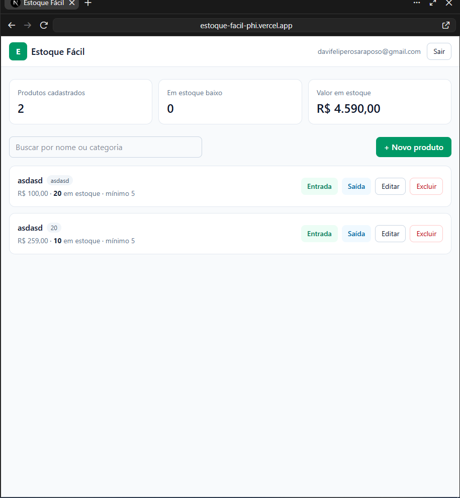

# Estoque Fácil

> 🔗 **Sistema publicado:** https://estoque-facil-phi.vercel.app

Controle de estoque simplificado para pequenos comércios. Permite cadastrar produtos, registrar entradas e saídas com histórico e receber alerta quando um item chega ao estoque mínimo. Cada usuário tem seu próprio estoque, isolado dos demais.

Atividade prática **"Desenvolvimento de um sistema simples utilizando Inteligência Artificial"**. Tema B: Controle de estoque simplificado.



## Funcionalidades

- Criar conta e entrar com e-mail e senha
- Cadastrar produto (nome, categoria, preço, quantidade inicial e estoque mínimo)
- Listar, pesquisar por nome ou categoria e consultar detalhes com histórico
- Editar nome, categoria, preço e estoque mínimo
- Excluir produto (com confirmação)
- Registrar **entrada** e **saída**: a quantidade é atualizada no servidor, de forma atômica, e saídas maiores que o saldo são recusadas
- Alerta de **estoque baixo** e resumo (total de produtos, itens em alerta e valor em estoque)
- Validação de campos com mensagens claras de sucesso e erro
- Layout responsivo (computador e celular)

## Tecnologias

| Camada | Tecnologia |
|---|---|
| Front-end e back-end | Next.js 16 (App Router, rotas de API) + TypeScript |
| Estilo | Tailwind CSS 4 |
| Banco de dados e login | Supabase (PostgreSQL + Auth) |
| Hospedagem | Vercel (plano Hobby, gratuito) |
| Testes | Vitest + PostgreSQL embutido (`embedded-postgres`) + Testing Library |
| IA utilizada | **Claude (Anthropic)**, para planejamento, geração de código, explicações e execução dos 4 prompts de auditoria |

### Por que essa persistência?

Os dados ficam no **PostgreSQL do Supabase**. O plano gratuito é permanente, é um banco relacional de verdade (com constraints, transações e Row Level Security) e já inclui login. Isso evita o armazenamento temporário de hospedagens gratuitas, que apaga os dados quando o serviço reinicia.

## Arquitetura

```
Navegador ──fetch──> /api/produtos/...  (Next.js, servidor na Vercel)
   │                       │  valida sessão (Supabase Auth) e dados
   │ login (Supabase Auth) │  SET ROLE estoque_app + app.usuario_id
   ▼                       ▼
Supabase Auth          PostgreSQL (Supabase)
                         ├─ RLS: cada usuário só vê as próprias linhas
                         ├─ CHECK: preço/quantidade nunca negativos
                         └─ app.registrar_movimentacao(): entrada/saída atômica
```

O navegador **não acessa as tabelas diretamente**. As regras de negócio ficam no servidor e no banco. Detalhes em `docs/prompts/PROMPT-1-SEGURANCA.md`.

```
src/
  app/page.tsx, app/login/page.tsx     telas
  app/api/produtos/**/route.ts         rotas de API (servidor)
  components/estoque/                  componentes da tela
  lib/cliente/                         tipos, formatação, formulário, chamadas à API
  lib/server/                          autenticação, banco, validação e regras (só servidor)
  proxy.ts                             renova a sessão e protege a navegação
supabase/migrations/                   schema, policies e função atômica (rodar em ordem)
tests/                                 testes de integração, de policies e de caracterização
docs/                                  planejamento, prompts, testes, evidências e deploy
```

## Como executar localmente

Pré-requisitos: Node.js 20 ou superior e um projeto gratuito no [Supabase](https://supabase.com).

```bash
git clone https://github.com/DaviFelipeRosaRaposo/estoque-facil.git
cd estoque-facil
npm install
cp .env.example .env.local      # preencha com os dados do seu Supabase
npm run dev                     # http://localhost:3000
```

No Supabase, rode **em ordem** no SQL Editor os três arquivos de `supabase/migrations/`. O passo a passo completo, incluindo a publicação, está em [`docs/DEPLOY.md`](docs/DEPLOY.md).

### Variáveis de ambiente

| Variável | Tipo | Onde encontrar |
|---|---|---|
| `NEXT_PUBLIC_SUPABASE_URL` | Pública | Supabase > Project Settings > API |
| `NEXT_PUBLIC_SUPABASE_PUBLISHABLE_KEY` | Pública (publishable/anon) | Supabase > Project Settings > API Keys |
| `DATABASE_URL` | **Secreta** (só servidor) | Supabase > Connect > Transaction pooler |
| `DATABASE_SSL_CA` | Opcional | Certificado em Project Settings > Database > SSL |

O `.env.local` não vai para o GitHub (está no `.gitignore`).

## Testes

```bash
npm test
```

Um único comando roda **72 testes**: 52 de integração, que chamam as rotas reais com um PostgreSQL de teste real e separado, e 20 de caracterização da tela. Não precisa de Docker nem do Supabase, e nunca toca o banco de produção. Cobrem CRUD, validações, limites, **requisições simultâneas**, **acesso de um usuário aos dados de outro** e **policies do banco**.

Detalhes, checklist manual e resultado: [`docs/TESTES.md`](docs/TESTES.md). Saída da execução: [`docs/evidencias/saida-testes.txt`](docs/evidencias/saida-testes.txt).

## Auditoria e qualidade (os 4 prompts)

| Ordem | Prompt | Resultado | Registro |
|---|---|---|---|
| 1 | Prompt 4: Auditoria completa (somente leitura) | 4 riscos altos encontrados na versão 1 | [`AUDITORIA.md`](AUDITORIA.md) |
| 2 | Prompt 1: Auditoria de segurança | Policies `USING (true)` removidas, regras movidas para o servidor e movimentação atômica | [`docs/prompts/PROMPT-1-SEGURANCA.md`](docs/prompts/PROMPT-1-SEGURANCA.md) |
| 3 | Prompt 3: Testes de integração | 52 testes passando com banco de teste real | [`docs/prompts/PROMPT-3-TESTES.md`](docs/prompts/PROMPT-3-TESTES.md) |
| 4 | Prompt 2: Refatoração segura | `page.tsx` de 614 para 202 linhas, sem mudar comportamento | [`docs/prompts/PROMPT-2-REFATORACAO.md`](docs/prompts/PROMPT-2-REFATORACAO.md) |

Resumo de achados, riscos e decisões: [`docs/RESUMO-PROMPTS.md`](docs/RESUMO-PROMPTS.md). O histórico de commits mostra cada etapa separadamente.

## Evidências

| Tela | Arquivo |
|---|---|
| Login | [`01-login.png`](docs/evidencias/01-login.png) |
| Painel com alerta de estoque baixo | [`02-painel.png`](docs/evidencias/02-painel.png) |
| Detalhes e histórico | [`03-detalhes-historico.png`](docs/evidencias/03-detalhes-historico.png) |
| Entrada inválida (validação) | [`04-validacao-campos.png`](docs/evidencias/04-validacao-campos.png) |
| Saída maior que o estoque | [`05-estoque-insuficiente.png`](docs/evidencias/05-estoque-insuficiente.png) |
| Celular | [`06-celular.png`](docs/evidencias/06-celular.png), [`07-celular-entrada.png`](docs/evidencias/07-celular-entrada.png) |
| Sistema publicado na Vercel | [`08-sistema-publicado.png`](docs/evidencias/08-sistema-publicado.png) |
## Autor

Davi — ADS, Faculdade COTEMIG.
